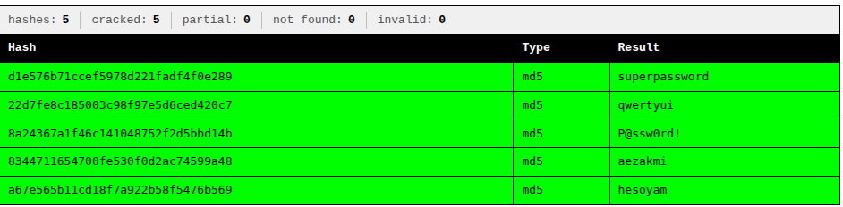

## Криптография

### 1. Аудит хэшей пользователей

```
SHA-256

user:MILO2008
admin:washington1776
web_admin:t061584
root:mmr431723
db_user:hxtour
```

### 2. Оптимальный подбор PIN-кода

```
SHA-512

75d25e48a3d92c398bb6a7873d6a22281f6bdd50f78956f666f717135190127cbbeec3fd35b9fb03925d6bf595baa022d10d247104cced3a0a8f4a6656c4bf6a:5472
684a71e209bad7d9c3a802386150a24b31be323e7e42624bbe787e381cfe0796820fb1aeabb45ec966c6e427babb5ece40824297dac97c37f2e41be6958ea324:497235
8f2090b09018f7431d25a92da885c6f3e80ea538778639072aa15b7484b44d92ecb6cae59350f3bd1846ab492e8604f8d3b25f0e5842c2335b0b03bae5e690c0:11082
7765080f31bffe1d14ff17db9316b538db5761ea5592454f3d7a71961567af39e91c1c60898bda23f0c6514b0c6ff8e3c830a22846fe1af94b2d6023c89449a1:4653
7c3a635c9bbedd8f74ddb9cdcea921368e728b6f65cdae7a6eec537748cf8831e57a8706494220b9caf695b4cb79aa655c7c6b635b49c1fdc318ea410c0ae49f:17456
```

### 3.Атака с учётом соли 

```
SHA-256

web_admin:656800
root:rubenkus
db_user:cup+preds
user:54cami9
admin:428248h
```

### 4*. Взлом MD5 через радужные таблицы 

```
d1e576b71ccef5978d221fadf4f0e289:superpassword
22d7fe8c185003c98f97e5d6ced420c7:qwertyui
8a24367a1f46c141048752f2d5bbd14b:P@ssw0rd!
8344711654700fe530f0d2ac74599a48:aezakmi
a67e565b11cd18f7a922b58f5476b569:hesoyam
```


